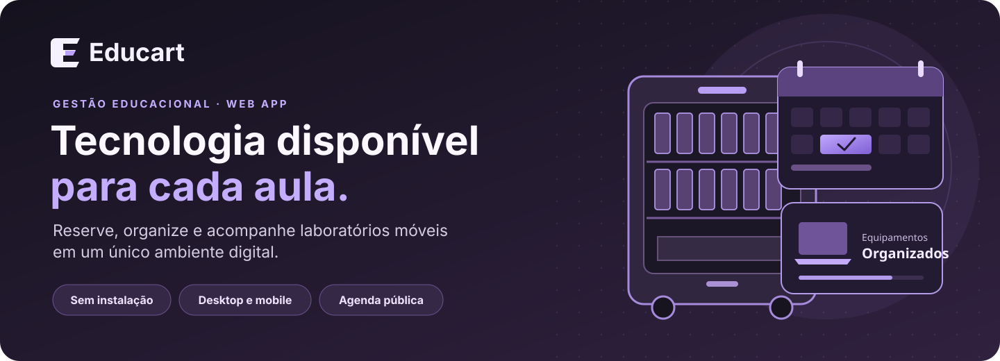
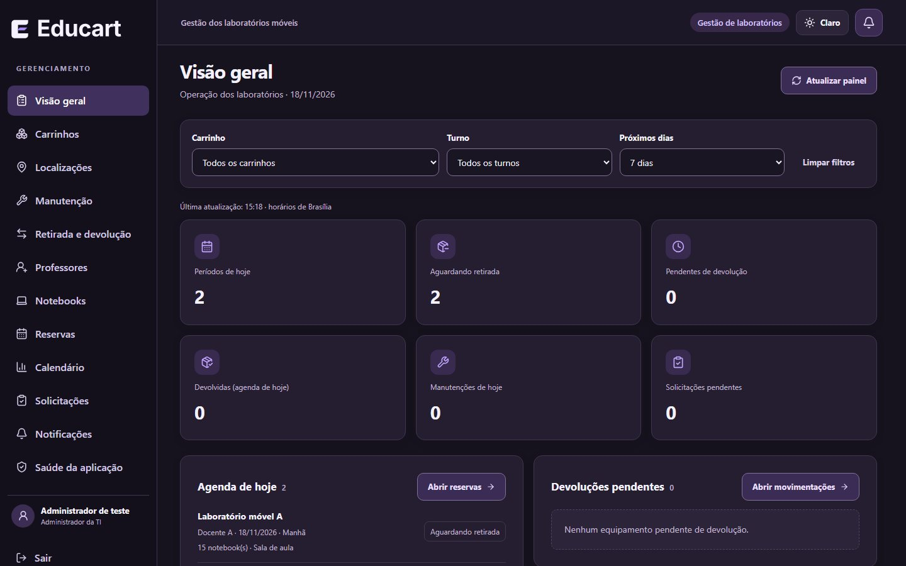
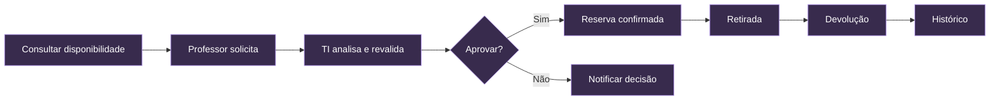
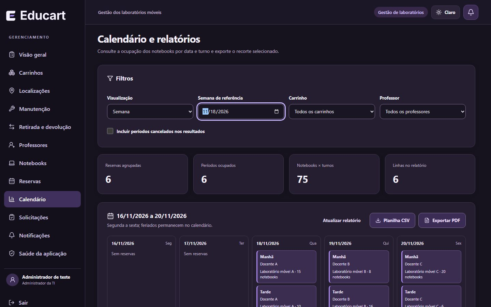
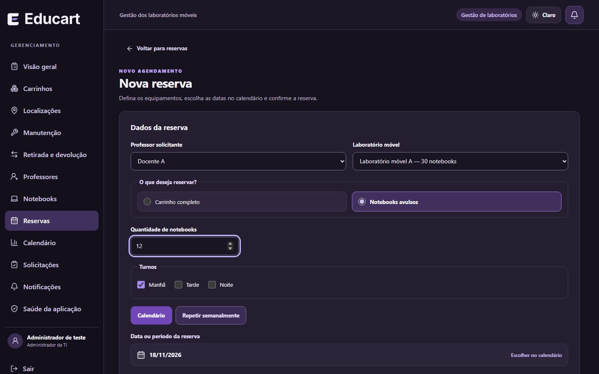
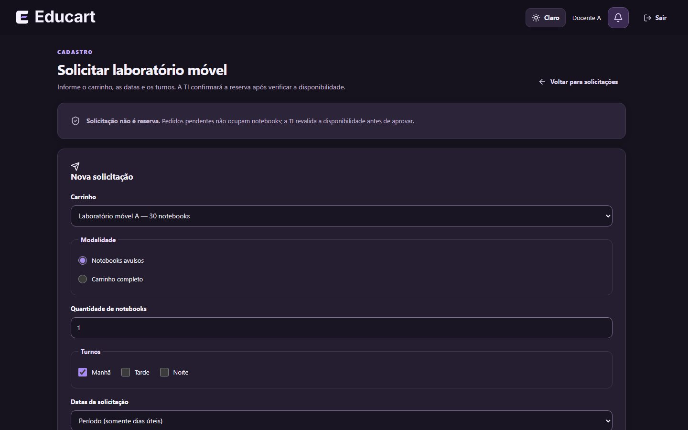
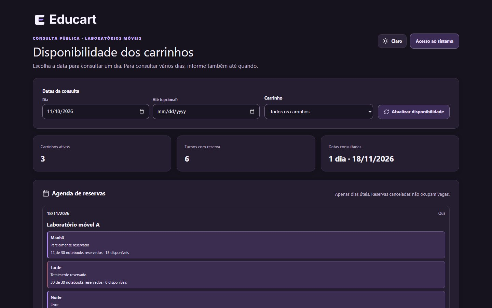
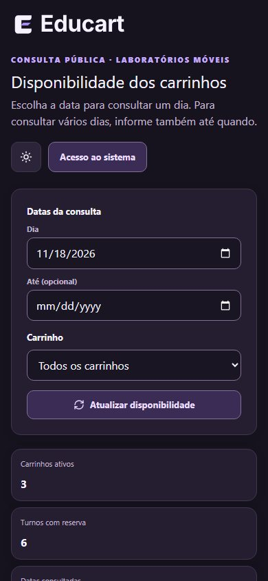

<div align="center">



# Educart

**Gestão inteligente de laboratórios móveis para instituições de ensino.**

[](https://dev-oestagiario.github.io/Educart/)
[](https://dev-oestagiario.github.io/Educart/#/consulta-publica)

[](https://github.com/dev-oestagiario/Educart/actions/workflows/verify.yml)
[](https://github.com/dev-oestagiario/Educart/actions/workflows/homologacao.yml)
[](https://github.com/dev-oestagiario/Educart/actions/workflows/recuperacao.yml)

[Proposta](#a-proposta) · [Funcionalidades](#funcionalidades) · [Galeria](#conheça-o-educart) · [Tecnologia](#tecnologia) · [Documentação](#documentação)

</div>

---

## A proposta

O Educart é uma plataforma web que organiza a utilização de carrinhos de notebooks e laboratórios móveis em escolas, centros de formação e outras instituições de ensino. Professores podem planejar atividades pedagógicas com acesso aos recursos tecnológicos, enquanto a equipe de TI centraliza a disponibilidade, as solicitações e o controle dos equipamentos.

Quando reservas são feitas por mensagens, anotações ou planilhas separadas, fica mais difícil consultar o saldo, evitar conflitos e acompanhar retiradas e devoluções. O Educart transforma esse processo em um fluxo integrado, do planejamento da aula à disponibilização e ao retorno dos notebooks.

O objetivo é **simplificar a gestão dos recursos educacionais, dar visibilidade à disponibilidade e tornar o uso dos equipamentos mais organizado** — sem exigir a instalação de um aplicativo nos dispositivos dos usuários.

<p align="center">
  
  <br/><sub>Painel administrativo · visão centralizada da operação (dados demonstrativos).</sub>
</p>

## Para quem é o Educart?

| Perfil | Experiência |
| --- | --- |
| **Professores** | Consultar o saldo, solicitar notebooks ou um carrinho completo, acompanhar a decisão da TI e receber notificações. |
| **Equipe de TI** | Gerenciar cadastros, reservas, solicitações, manutenção, retirada e devolução, localizações e relatórios. |
| **Comunidade escolar** | Consultar a disponibilidade de equipamentos por dia e turno, sem criar conta ou expor dados pessoais dos solicitantes. |

## Funcionalidades

| Recurso | O que permite |
| --- | --- |
| **Reservas inteligentes** | Agendar por data, turno e quantidade; reservar o carrinho completo ou notebooks avulsos; definir recorrência semanal e exceções. |
| **Controle de disponibilidade** | Consultar saldo e impedir confirmação de reservas incompatíveis com a capacidade ou manutenção. Pedidos pendentes não ocupam saldo até aprovação. |
| **Portal do professor** | Criar solicitações, acompanhar aprovações, rejeições e retiradas de pedidos pendentes. |
| **Inventário** | Organizar carrinhos, notebooks, professores e locais; importar códigos de notebooks em CSV/XLSX. |
| **Ciclo operacional** | Registrar manutenção, retirada física, devolução e histórico de alterações. |
| **Calendário e relatórios** | Visualizar ocupação semanal/mensal, aplicar filtros e exportar CSV ou PDF. |
| **Consulta pública** | Ver a disponibilidade por dia, intervalo de dias úteis, carrinho e turno sem autenticação. |
| **Experiência web responsiva** | Acessar em computadores, tablets e celulares, com temas claro e escuro. |

### Como funciona



A consulta pública informa o saldo; a solicitação do professor não é uma reserva confirmada. A equipe de TI aprova o pedido após verificar a disponibilidade, e o sistema registra o ciclo operacional.

## Conheça o Educart

<table>
<tr>
<td width="50%" valign="top">
<strong>Calendário e relatórios</strong><br/>
<br/>
<sub>Planejamento de aulas e acompanhamento da ocupação dos carrinhos.</sub>
</td>
<td width="50%" valign="top">
<strong>Nova reserva</strong><br/>
<br/>
<sub>Escolha de professor, laboratório, quantidade, datas e turnos.</sub>
</td>
</tr>
<tr>
<td width="50%" valign="top">
<strong>Portal docente</strong><br/>
<br/>
<sub>O professor solicita os equipamentos e acompanha a resposta da TI.</sub>
</td>
<td width="50%" valign="top">
<strong>Consulta pública</strong><br/>
<br/>
<sub>Transparência na disponibilidade, sem autenticação.</sub>
</td>
</tr>
</table>

### Pensado para acompanhar a rotina escolar

<table>
<tr>
<td width="30%" align="center">

</td>
<td width="70%" valign="middle">

**Do computador da TI ao celular do professor.**

O Educart roda no navegador, adapta a navegação à largura da tela e oferece temas claro e escuro. Não é necessário baixar um instalador, configurar um banco de dados ou manter um aplicativo desktop.

- Consulta rápida antes da aula.
- Planejamento de reservas pela web.
- Gerenciamento centralizado pela equipe autorizada.

[Experimentar a consulta pública →](https://dev-oestagiario.github.io/Educart/#/consulta-publica)

</td>
</tr>
</table>

<sub>Capturas da interface produzidas em ambiente de teste com dados sintéticos. Os valores e registros são ilustrativos, não representam uma instituição ou dados reais.</sub>

## Tecnologia

<div align="center">


</div>

O front-end utiliza React, TypeScript e Vite, com Tailwind CSS, Zustand, TanStack Query e Zod. A persistência e autenticação utilizam Supabase/PostgreSQL, com políticas de acesso em nível de linha (RLS) e operações transacionais no banco. GitHub Actions executa verificações, homologação isolada e o fluxo controlado de publicação no GitHub Pages.

- **Segurança:** autenticação, autorização por perfil, RLS e consulta pública com dados limitados de disponibilidade.
- **Qualidade:** testes unitários, Playwright, auditoria de dependências, homologação com Supabase isolado e ensaio de recuperação com dados sintéticos.
- **Observabilidade:** integração Sentry com eventos sanitizados, sem conteúdo de reservas ou dados pessoais nos eventos da aplicação.

## Documentação

### Usuários

O acesso é pela [aplicação web](https://dev-oestagiario.github.io/Educart/). Professores e administradores precisam de conta autorizada pela instituição; a consulta pública é aberta.

| Guia | Conteúdo |
| --- | --- |
| [Manual do professor](docs/manual-professor.md) | Acesso, disponibilidade, solicitações e acompanhamento. |
| [Manual do administrador](docs/manual-administrador.md) | Cadastros, reservas, manutenção, movimentações e relatórios. |
| [Guia de acesso e suporte](docs/guia-acesso-suporte.md) | Login, dúvidas e suporte institucional. |

### Mantenedores

| Documento | Conteúdo |
| --- | --- |
| [Arquitetura e operação](docs/arquitetura-operacional.md) | Componentes, configuração de desenvolvimento e homologação isolada. |
| [Roadmap](docs/roadmap-finalizacao-educart.md) · [Baseline F0](docs/f0-integracao-baseline.md) | Desenvolvimento e integração das etapas do projeto. |
| [Migrations](docs/catalogo-migrations.md) | Evolução do banco e atualização controlada. |
| [Backup e recuperação](docs/f6-1-backup-recuperacao.md) | Procedimentos, ensaios e riscos operacionais. |
| [Monitoramento](docs/f6-2-operacao-monitoramento.md) · [Sentry](docs/sentry.md) | Diagnóstico e observabilidade. |
| [Publicação e reversão](docs/checklist-publicacao.md) | Critérios de promoção e validação do deploy. |
| [Gêmeo digital V2](docs/educart-3d-v2.md) · [Homologação 3D](docs/f5-6-homologacao-3d.md) | Ambiente 3D experimental de desenvolvimento administrativo. |

<details>
<summary>Engenharia e contribuição</summary>

As skills de [Matt Pocock](https://github.com/mattpocock/skills) estão em `.agents/skills/` para engenharia, especificação, TDD, revisão e triagem. Mantenedores podem optar pela instalação gerenciada no Codex:

```bash
codex plugin marketplace add mattpocock/skills
codex plugin add mattpocock-skills@mattpocock
```

Escolha apenas um método por agente (plugin gerenciado ou cópia local). A licença upstream está em [UPSTREAM_LICENSE](.agents/skills/UPSTREAM_LICENSE). Ferramentas de desenvolvimento são exclusivas da equipe técnica; não são necessárias para professores.

</details>

## Estado do produto

A candidata de lançamento passou pela homologação automatizada de 11 suítes com Supabase isolado, incluindo fluxos de API e navegador, além do ensaio de recuperação sintética. Consulte o [histórico das publicações](https://github.com/dev-oestagiario/Educart/actions/workflows/pages.yml) para acompanhar o deploy.

O aceite institucional, a verificação operacional dos alertas e a política de backup de produção são responsabilidades de operação. O backup de produção está adiado e não há garantia de recuperação dos dados reais. A visualização 3D V2 permanece experimental e restrita ao desenvolvimento administrativo; não é telemetria ou controle físico de equipamentos. A versão publicada pode diferir das capturas da candidata.

---

<div align="center">

**Educart** — organizar os recursos tecnológicos para que o foco continue sendo a educação.

[Aplicação web](https://dev-oestagiario.github.io/Educart/) · [Consulta pública](https://dev-oestagiario.github.io/Educart/#/consulta-publica) · [Issues](https://github.com/dev-oestagiario/Educart/issues)

</div>
