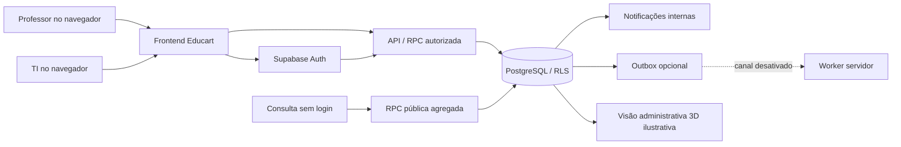

# Arquitetura e operação técnica — Educart

Documento exclusivo da equipe de manutenção. O usuário final acessa pelo navegador; não instala o sistema. Este documento descreve a versão acumulada em preparação, não a infraestrutura efetivamente homologada.

## 1. Componentes e fronteiras
- Aplicação estática React/TypeScript, compilada com Vite, estilos Tailwind/CSS e componentes acessíveis. GitHub Pages é o destino previsto para o frontend; o navegador executa a interface.
- Supabase Auth autentica usuários; a autorização depende de admin_users e vínculos ativos de professores. As políticas RLS, grants e RPCs do PostgreSQL protegem os dados independentemente da tela. Nenhuma chave privilegiada pode chegar ao navegador.
- TanStack Query controla consultas, invalidação e estados; Zustand mantém estado da navegação. A disponibilidade precisa ser revalidada no banco ao salvar. Nenhum cache define o saldo.
- PostgreSQL é fonte de verdade para carrinhos, capacidade, reservas, períodos, identificação, manutenção e movimentações. As operações agrupadas são transacionais; registros de auditoria preservam o histórico.
- Consulta pública, via public_cart_availability, oferece somente projeção agregada, sem professor, observações, patrimônio, histórico ou plantas. Não adicionar dados administrativos a essa rota.
- Three.js: ambiente ilustrativo V2 administrativo, lazy loading, GLB próprios, fallback em lista, seleção e inspeção. Somente DEV com flags; não integra controle físico. Posições visuais não provam localização atual.
- Notificações internas são parte da operação. E-mail opcional usa outbox e worker server-side; provedor/transporte/agendamento continuam pendentes. A fila deve permanecer desativada até aceite.
- Diagnóstico F6.2 registra categorias, resultados e latências em memória por aba; não é central de telemetria. Probe de deploy é consulta HTTP independente e somente leitura.

## 2. Fluxo de dados

## 3. Configuração técnica do ambiente
Apenas para desenvolvimento, QA e manutenção, não para professor ou TI usuária do site. Use Git, Node compatível com o lockfile (workflow atual usa 22; ensaios recentes usaram Node 24.9), npm e um navegador de teste. Em clone autorizado, npm ci e npm run dev com servidor em loopback. Defina apenas VITE_SUPABASE_URL e VITE_SUPABASE_PUBLISHABLE_KEY em arquivo local ignorado; nunca incluir service_role, credencial de banco ou segredos em VITE_.

Para testes de Auth/PostgREST reais, siga [homologação isolada](f1-4-homologacao.md), que usa Docker e CLI fixada em 2.79.0 no workflow. Modo homologacao aceita somente localhost/127.0.0.1:54321; não contornar essa proteção para apontar ao banco de produção. PGlite é complementar, com Auth simulado, e não substitui concorrência real/HTTP.

Ambientes disponíveis devem ser confirmados pela TI; não se presume projeto extra hospedado. Não provisionar serviços ou contratar plano sem autorização.

## 4. Segurança operacional
- Provisionar administrador explicitamente por responsável autorizado; verificar confirmação de e-mail e vínculos. Revogar acessos por fluxo institucional.
- Segredos em cofre; nenhum dado real em fixtures, prints, Git, logs ou chamados públicos. Verificar RLS e anon antes de publicar.
- Migrations incrementais conforme [catálogo](catalogo-migrations.md); nunca editar migrations já aplicadas. Antes de atualização, plano de backup, rollback e homologação.
- Produção: workflow Pages apenas na main, audit, Vitest, E2E, build e version.json. GitHub Actions está sem cota disponível, portanto teste local não comprova deploy; não contornar o gate nem publicar sem autorização.
- Gestão de incidentes: [backup/recuperação](f6-1-backup-recuperacao.md), [monitoramento](f6-2-operacao-monitoramento.md), [checklist de publicação](checklist-publicacao.md).

## 5. Referências
[Especificação funcional](especificacao-funcional.md), [modelo de dados histórico](modelo-de-dados.md), [fluxos de tela](fluxos-de-tela.md), [roadmap](roadmap-finalizacao-educart.md), [ADR 0004 — capacidade](adr/0004-capacidade-configurada-e-disponibilidade.md), [ADR 0005 — persistência espacial](adr/0005-persistencia-espacial-administrativa.md). Migrations e código atuais prevalecem sobre diagramas históricos.
