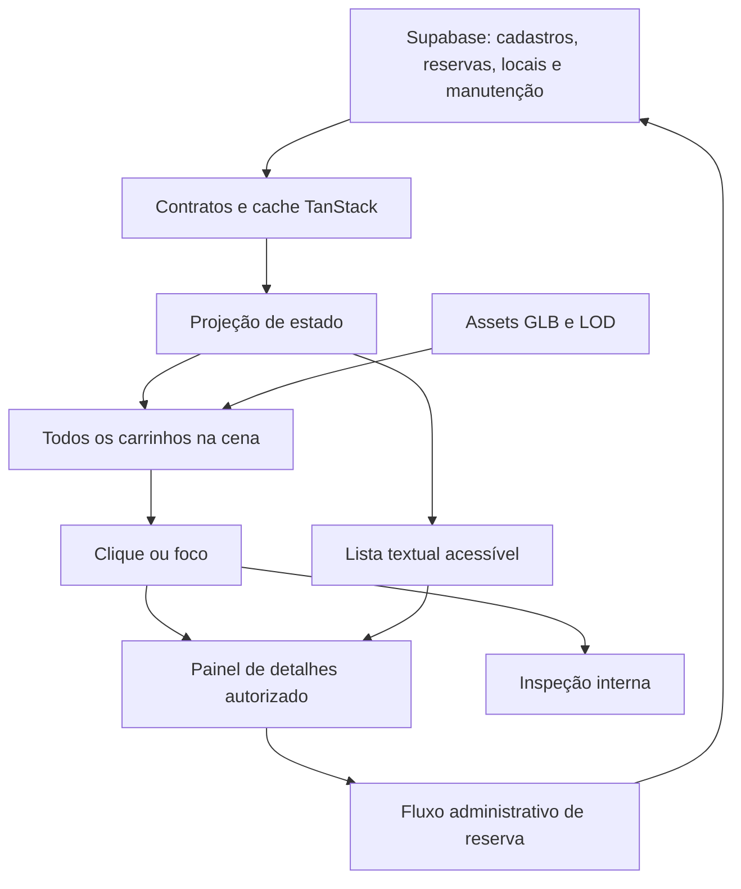

# Educart 3D V2 — Especificação e plano técnico do gêmeo digital

**Estado:** protótipo F5.0 e fundação F5.1 implementados em desenvolvimento; referências reais, homologação visual e Supabase completo pendentes. Veja [registro F5.0](f5-0-prototipo-ambiente-3d.md). **Fase:** F5 do [roadmap consolidado](roadmap-finalizacao-educart.md).
**Objetivo:** transformar a visualização isolada de um carrinho em um ambiente virtual detalhado e interativo, com todos os carrinhos simultaneamente, inspeção de notebooks e informações operacionais.

## 1. Problema e baseline

O código atual `src/pages/Visual3DPage.tsx` exige selecionar `cartId`, consulta períodos somente desse carrinho, deriva posições via `buildCartSlots` em `src/lib/cartScene` e renderiza `Cart3DCanvas`. `src/App.tsx` mantém a rota administrativa, mas o acesso pelo menu está ocultado. Three.js 0.180.0 já é dependência. O cadastro de carrinho contém código/nome/capacidade, sem campo de sala ou transformação espacial na interface. A ADR 0003 preserva a separação entre ocupação real e visualização. Não descartar essa lógica de domínio: migrar a interface, separar renderização, ampliar contratos de consulta e manter rastreabilidade.

## 2. Experiência desejada

### Visão inicial (sem seleção obrigatória)

- Menu **Ambiente 3D** abre a cena geral, câmera isométrica/ortográfica mostrando ambiente e todos os carrinhos, com mapa ou miniatura de navegação quando útil.
- Sala de TI, corredores, setores, mobiliário e iluminação modelados com referências autorizadas. Várias salas podem aparecer numa visão de conjunto com paredes recortáveis e foco por ambiente; demais campus têm seleção de navegação opcional, nunca um filtro obrigatório para escolher carrinho.
- Cada carrinho aparece como objeto reconhecível e clicável, com etiqueta de código/nome e indicador de disponibilidade. Carrinhos sem localização confirmada aparecem em área virtual explícita **Sem localização definida**; não os omitir ou duplicar.
- Barra compacta: data, turno, busca por nome/código, retorno à visão geral, ajuda de controles e qualidade visual. Por padrão, todos os carrinhos, data corrente no fuso institucional (fim de semana indicado), turno explicitamente identificado; filtros opcionais por local/status não escondem silenciosamente ativos.
- Legenda indica estado com cor + texto/símbolo. Livre, parcial, totalmente reservado, indisponível/manutenção, inativo e carregando/desconhecido são distinguíveis. Reserva e condição física são dimensões separadas (ex.: carrinho parcialmente reservado e um equipamento em manutenção).
- Orbitar, zoom, pan, enquadrar todos, foco por busca/seleção, controles também por teclado e toque. Nada de câmera que gira automaticamente sem controle.

### Clique em qualquer carrinho

Painel lateral (desktop) ou painel inferior/página de detalhes (mobile), sem perder contexto da cena:
- Código, nome, modelo, capacidade nominal, capacidade efetiva para a data/turno, total reservado, livre, indisponível.
- Local de guarda, localização registrada em movimentação quando existir, sala de destino da reserva separadamente. Mostrar fonte e timestamp quando disponível; não afirmar rastreamento físico em tempo real.
- Reservas confirmadas do período: professor, turno, quantidade, modalidade, sala, mouse e observações, com acesso ao detalhe existente conforme autorização. Próxima reserva é um período futuro de fato, não a seleção atual; busca limitada e mensagem de indisponibilidade quando não consultada.
- Status operacional e manutenção; última movimentação registrada; indicador de dados atualizados.
- Ações **Inspecionar carrinho**, **Ver reservas**, **Voltar à visão geral**. Qualquer alteração chama o fluxo administrativo existente, nunca modifica o estoque pelo mesh.

### Inspeção detalhada

- Câmera aproxima suavemente o carrinho, permite girar em torno, ver todas as faces e interior, com opção de abrir portas em animação, recorte ou vista explodida.
- Geometria detalhada: estrutura metálica, revestimentos, maçaneta, dobradiças, ventilação, rodas/travas, compartimentos, divisórias, suportes, etiquetas, cabos de carregamento e conectores visíveis conforme o modelo real. Não reproduzir cabeamento de infraestrutura sensível em publicação pública.
- Notebooks individuais em posições visuais, com tampa, teclado/trackpad, tela, entradas, texturas e materiais adequados ao nível de zoom. Dar prioridade à fidelidade do carrinho real; sem referência, usar **modelo ilustrativo** identificado.
- Portas, compartimentos, notebooks e pontos de interesse selecionáveis. Hotspots de estrutura mostram descrição, não falso estado de energia/temperatura/conectividade.
- Ao clicar num notebook: posição física se confirmada, código/patrimônio quando disponível, condição operacional registrada, reserva associada se houver vínculo confirmado e dados permitidos. Quando não houver código ou mapeamento confirmado, indicar posição ilustrativa / ocupação agregada, nunca atribuir um professor a um notebook arbitrário.
- Todas as ações de consulta têm correspondentes textuais/lista pesquisável, disponíveis sem WebGL. O usuário pode desligar 3D, reduzir animação e retornar sem perder data/turno.

## 3. Requisitos funcionais (RF3D)

| ID | Requisito | Aceite |
|---|---|---|
| RF3D-01 | Visão global de todos os carrinhos | N carrinhos cadastrados elegíveis aparecem uma vez na cena/lista sem escolha prévia; não posicionados têm área explícita. |
| RF3D-02 | Explorar espaços modelados | Navegar, girar, focalizar sala/carrinho, retornar à visão global; salas sem medidas não se passam por réplicas. |
| RF3D-03 | Selecionar carrinho | Clique/tap/teclado/busca apontam ao mesmo ID e painel correto; destaque sincronizado. |
| RF3D-04 | Dados por data/turno | Alterar seleção atualiza todos os indicadores; totais batem com backend; erro não vira livre. |
| RF3D-05 | Renderização detalhada | Exterior, interior, portas, compartimentos, notebooks e cabos inspecionáveis conforme referências. |
| RF3D-06 | Seleção de objetos internos | Hotspots e notebooks mostram metadados pertinentes; vínculos aparentes nunca inventados. |
| RF3D-07 | Localização administrativa | TI edita local e pose (posição/rotação) no editor espacial; valida ambiente, limites e conflitos; mantém log. |
| RF3D-08 | Permissões e privacidade | Módulo administrativo; nenhum detalhe interno, nome ou planta exposto ao anon/professor sem requisito e autorização específicos. |
| RF3D-09 | Alternativa acessível | Lista equivalente funciona com WebGL desativado, teclado, leitor de tela ou rede lenta. |
| RF3D-10 | Atualização consistente | Invalidação ao confirmar/editar/cancelar, manutenção/movimentação; revalidação em foco e atualização periódica, visível. |
| RF3D-11 | Modelos e versões | Administrador associa modelo por tipo/carrinho; modelo padrão licenciado; falha de asset usa geometria simples sem perder dados. |
| RF3D-12 | Histórico | Consulta a eventos de reserva e de movimentação conforme autorização; históricos separados de estado atual. |

## 4. Modelo de dados proposto

F3.1 implementa cadastro base; F5.1 estende apenas o que faltar após revisar migrations e schema reais. Nomes são sugestões, não estruturas já existentes.

| Entidade / extensão | Campos essenciais | Observações |
|---|---|---|
| campuses | id, name, active | Local institucional. |
| buildings | id, campus_id, name, active | Bloco/edifício. |
| rooms | id, building_id, name, code, floor, active | Sala/ambiente; guarda ou destino definido por relação. |
| carts (existente) | storage_room_id nullable, model_id nullable | Local de guarda não é localização instantânea. |
| reservations (existente) | destination_room_id nullable | Destino informado na reserva, separado de guarda. |
| spatial_scenes | id, room_id, model_asset_id, dimensions, version | Unidade metros, Y para cima, origem documentada e revisão. |
| cart_scene_placements | cart_id, scene_id, position_x/y/z, yaw, version, updated_by, updated_at | Único posicionamento ativo; validações de limites e autorização. |
| asset_models | id, kind, storage_path, version, checksum, author, license, source, scale, active | GLB, texturas, LOD e referências; sem URL arbitrária. |
| cart_model_slots | model_id, slot_key, transform, description | Posições da geometria, não inventário real. |
| notebook_slot_links | cart_id, slot_key, notebook_id, confirmed_by, confirmed_at | Opcional; unicidade slot/notebook ativo e pertencimento ao carrinho; sem vínculo fictício. |
| maintenance / movement events | conforme F3.2/F3.3 | Evitar duplicar capacidade, estado ou histórico em tabela do renderer. |

Segurança: RLS por papel, leitura/escrita administrativa; chaves e assets internos em Storage privado com URL assinada ou entrega autorizada; assets genéricos não sensíveis podem ser empacotados com o front. Modelos de ambientes reais e referências não devem entrar em repositório público sem autorização. Validar tamanho, formato e licença de assets; não carregar scripts externos de modelos. Migrations aditivas, default nullable e reversão sem apagar reservas.

## 5. Arquitetura

- Manter React + TypeScript, Vite, Three.js existente, TanStack Query, Zustand para seleção/câmera/qualidade/estado transitório; Supabase e Zod para dados e contratos.
- Começar com Three.js direto para reaproveitar conhecimento e evitar migração desnecessária. Avaliar React Three Fiber somente se um ADR demonstrar ganhos em componentes/recursos e compatibilidade com React; não trocar motor por estética.
- Assets GLB/glTF exportados de Blender ou ferramenta equivalente, PBR, unidades/referências, UVs, nomes de nós estáveis e manifesto de hotspots. Modelo padrão de ambiente e carrinho; modelos por tipo conforme referências. Separar geometria estática de estado.
- Camada de domínio: computar estados com as mesmas regras de reserva/manutenção, revisar `buildCartSlots` para separar quantidade ocupada de associação confirmada. Preferir uma RPC de agregados administrativamente autorizada para todos os carrinhos por data/turno; evitar N+1 e consultas de todos os dados pessoais automaticamente. Buscar detalhes somente ao selecionar, com cache e invalidação.
- Composição: `DigitalTwinPage` (tela/toolbar), `EnvironmentCanvas` (cena e ciclo WebGL), `SceneAssetLoader`, `CartInstance`, `CartInspector`, `ObjectHotspots`, `CartDetailsPanel`, `SpatialEditor`, `AccessibleEquipmentList`; nomes propostos. Adaptar página/rota existentes, manter seleção por ID estável.
- Contrato sugerido de resumo admin: cart_id, code, name, location_id, model_id, nominal_capacity, effective_capacity, reserved, available, maintenance_count, operational_status, availability_status, snapshot_at. Detalhes retornados para ID autorizado, com lista de reservas/atribuições confirmadas. Não duplicar lógica SQL de saldo no renderer.
- Realtime opcional: eventos autorizados invalidam cache, sem replicar dados sensíveis. Começar por polling controlado e invalidação após mutações; indicar dados defasados/erro. Subscrições, RAF, listeners, geometrias e texturas devem ser liberados ao desmontar.

## 6. Design visual e performance

**Direção:** semirrealista de alta fidelidade no conjunto, detalhamento máximo nos objetos em inspeção (metal, cabos, encaixes, etiquetas, acabamento), luz ambiente e sombras controladas. Aproximar-se de um visualizador técnico de infraestrutura, não de um modelo de formulário com caixas. Ambiente realista somente com dados autorizados e revisão visual. Evitar depender de iluminação pesada ou centenas de labels no canvas.

**Metas propostas para protótipo:** definir hardware de referência e cenários com 10/30 carrinhos (sem impor limite comercial). Buscar 30 FPS sustentados em desktop de referência e qualidade mobile adaptada; inicializar shell e lista sem aguardar downloads de modelos. Medir FPS/p95 frame time, bytes transferidos e consumo de memória; não declarar metas atingidas sem benchmark. LOD distante simplificado, instancing/batching para notebooks/objetos repetidos, texturas comprimidas, carregamento prioritário do selecionado, culling, limite de pixel ratio, sombras/bloom opcionais, render sob demanda quando cena parada. Baixa qualidade e lista continuam disponíveis. Evitar gerar geometria de todos os detalhes para cada carrinho quando distante. Testar perda de contexto WebGL e repetir entrada/saída sem crescimento persistente de memória.

Acessibilidade: texto acompanha cor; foco visível, botões rotulados, sequência lógica; painel sem aprisionar foco, Escape e voltar; respeitar reduced-motion; WCAG 2.2 AA como meta, navegação por teclado e toque. Em mobile, painel inferior deslocável, controles grandes, orientação e 320/390px sem overflow.

## 7. Tarefas de implementação

### F5.0 — Constitution / Specify / protótipo
- [x] DT-001 Confirmar escopo administrativo, fontes, permissões, inventário e modos de visualização.
- [ ] DT-002 Coletar apenas fotos e dimensões autorizadas (sala, mobiliário, carrinhos, notebooks); inventário de modelos e licença, sem dados pessoais em imagens.
- [ ] DT-003 Wireframe da tela ampla e mobile, storyboard de clique/inspeção; protótipo de sala ilustrativa com 3+ carrinhos. Definir padrão visual e orçamento técnico; aprovar antes da modelagem detalhada. Protótipo e orçamento inicial implementados; aceite visual pendente.

### F5.1 — Fundação de dados (depende F3.1/F3.2)
Implementação e testes locais: [F5.1](f5-1-fundacao-espacial.md). Editor numérico; importação em lote e drag 3D ficam para depois; Auth real e aceite da TI pendentes.
- [x] DT-004 Revisar schema/migrations/RLS existentes e elaborar ADR do modelo espacial; migrar tabelas aditivamente, índices e policies.
- [x] DT-005 CRUD de ambientes e posicionamento; área sem localização; importação/edição de medidas e poses com validação e versão/registro.
- [x] DT-006 RPC agregada por data/turno, contratos de detalhe e autorização negativa (anon/professor/conta sem vínculo).
- [x] DT-007 Mapeamento opcional slot/notebook físico; preservar capacidade sem código e impedir associação falsa/duplicada.

### F5.2 — Experiência de visão geral
- [x] DT-008 Criar layout canvas + toolbar + painel, carregar todos sem seleção; manter lazy load e dados acessíveis.
- [x] DT-009 Cena com salas/ambientes e carrinhos, seleção por raycast/ID, destaque, camada de etiquetas, câmera e navegar todos.
- [x] DT-010 Painel de status/ocupação/reservas e localização registrada, atualização de data/turno e tratamento de erro; busca opcional.
- [ ] DT-011 Testar carrinhos sem posição, 0/1/N ativos, estados mistos, dados defasados, troca de turno e filtros.

### F5.3 — Assets detalhados
- [x] DT-012 Pipeline GLB original reproduzível, manifesto de escala, direitos e hotspots; materiais PBR e modo econômico. Blender não obrigatório para os assets procedurais; LOD de distância fica na F5.5.
- [x] DT-013 Modelo ilustrativo com paredes em corte, piso, porta e mobiliário genérico (mobiliário não posicionado na cena registrada). Corredores reais e revisão visual aguardam referências.
- [x] DT-014 Modelo ilustrativo exterior/interior com dobradiças, ventilação, compartimentos, rodas, cabos/conectores e etiqueta; cabe no footprint cadastrado, altura ilustrativa.
- [x] DT-015 Modelo genérico de notebook, posições de exemplo repetíveis, sem equivalência com slots físicos; fallback e modo econômico preservam dados. Associação por tipo real e vínculos na F5.4, condicionados a referências.
- [ ] DT-016 Revisão visual das referências e aprovação do realismo/modelagem antes de declarar réplica. Chromium/WebGL ainda pendentes.

### F5.4 — Inspeção e interação
- [x] DT-017 Foco/sair, rotação/zoom, porta virtual articulada e hotspots por raycast e controles de teclado; validação visual pendente.
- [x] DT-018 Inspeção de exemplares ilustrativos sem atribuir dados reais. Lista textual separada de vínculos confirmados, reserva e histórico individual por UUID. Mapeamento físico sobre a geometria depende de referência aprovada.
- [x] DT-019 Navegação para cadastros, reservas, manutenção e histórico por páginas existentes, sem mutação de dados por interação 3D.
- [ ] DT-020 Invalidação espacial, polling e timestamps implementados; comprovação integral de consistência com dashboard, relatórios e consulta pública pendente na homologação.

### F5.5 — Otimização e fallback
- [ ] DT-021 LOD, instancing, lazy loader, cache/descarte, modo adaptativo e render sob demanda implementados. GLB já compactos (46.360 bytes); compressão adicional não adotada sem medição de benefício.
- [ ] DT-022 Lista paginada, controles mobile, modo automático e reduced-motion implementados; teste real de navegador, contraste, rede e zoom pendentes.
- [ ] DT-023 Perfil estrutural sintético de 120 carrinhos: 21.240 → 2.124 nós detalhados no limite de 12. GPU/FPS, memória real e homologação pendentes.

### F5.6 — Homologação e publicação
- [ ] DT-024 Vitest 124/124 e SQL/RLS local isolado aprovados; JWT/PostgREST e concorrência real pendentes.
- [ ] DT-025 Cenários Playwright ampliados: quatro estados, inspeção, período, fallback, teclado e seis larguras; execução real e screenshots pendentes.
- [ ] DT-026 Homologar com dados controlados reais e referências físicas, registrar matriz de aceite e falhas; validar modelo indicado como real/ilustrativo.
- [ ] DT-027 Publicação bloqueada pelos gates de segurança/dependências, navegador e aceite. ADR 0003 atualizado; menu DEV preservado. Ver [matriz F5.6](f5-6-homologacao-3d.md).
 
## 8. Cenários essenciais de aceite

- Dois carrinhos no mesmo ambiente (livre e parcialmente reservado), um totalmente reservado e um em manutenção: todos renderizados, etiqueta/estado correto, clique abre respectivos dados.
- Adicionar novo carrinho sem localização: ele aparece na área sem localização e na lista; ao posicionar, permanece único.
- Carrinho de capacidade 30 com 28 identificadores: capacidade nominal 30 (salvo regra explícita de manutenção); não inventar os outros dois códigos. Reserva de 10 reduz saldo em 10 no turno correto.
- Mesmo notebook reservado em outro turno: distinguir estados. Sem associação física, não afirmar posição ocupada por pessoa específica.
- Erro de RPC ou perda de WebGL: não mostrar livre; lista/fallback e ação tentar novamente disponíveis.
- Consulta pública anônima continua funcionando sem capturar dados administrativos ou espaciais privados.
- Todos os filtros e dados mantêm consistência em tema claro/escuro, lateral/painel inferior, teclado e toque.
- Assets genéricos são explicitamente ilustrativos; representação de campus real exige referências autorizadas, validação e aprovação visual.

## 9. Fora do escopo inicial

GPS, sensores IoT, telemetria elétrica/temperatura, monitoramento de rede, controle físico de portas, reconstrução automatizada de campus por fotos e navegação de pessoa em tempo real não fazem parte desta fase. Podem ser avaliados futuramente com hardware, dados e autorização próprios. O 3D é uma visualização rica do estado registrado, não monitoramento físico automático.
