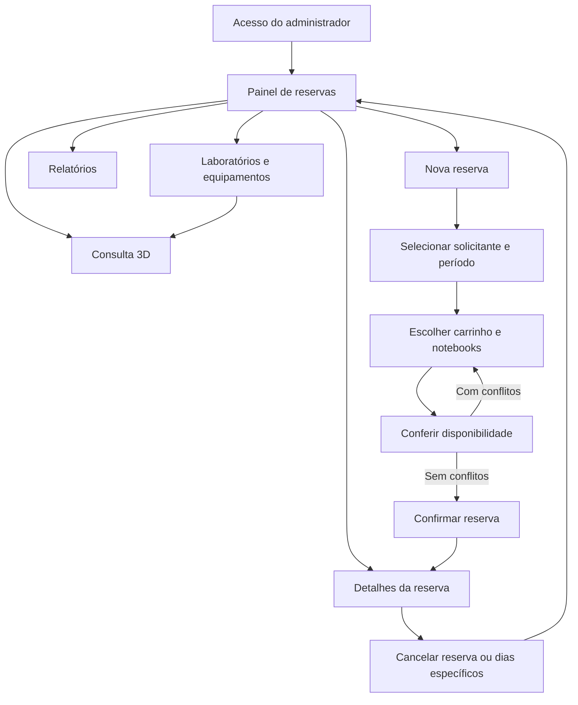

# Educart — Fluxos de tela (proposta inicial)

**Estado:** detalhamento de UX proposto a partir da especificação funcional; estrutura de navegação ainda sujeita a validação.
**Público da primeira versão:** administradores da equipe de TI.
**Fonte das regras:** [Especificação funcional](especificacao-funcional.md).

## Mapa de navegação proposto

## T01 — Acesso administrativo

**Objetivo:** identificar o usuário que executará registros e cancelamentos.

- Tela de entrada com identificação do administrador.
- Ao autenticar, acessar o painel de reservas.
- A reserva guarda o registrante automaticamente. Solicitante é informado separadamente.
- Método de autenticação e gestão de usuários ainda não definidos; **não desenhar credenciais fixas como decisão do projeto**.

## T02 — Painel de reservas

**Objetivo:** organizar a distribuição de equipamentos no dia a dia.

**Elementos propostos:** alternância semanal/mensal, navegação entre períodos, busca/filtros por solicitante, carrinho, turno e situação, lista/calendário de reservas, indicação de disponibilidade, ações Nova reserva, Detalhes, 3D e Exportar.

**Estados:**
- Sem reservas: mostrar informação de ausência e ação para cadastrar.
- Com reservas: cada item mostra data/turno, solicitante, carrinho, modalidade e ocupação.
- Reserva cancelada: manter no histórico sem ocupar disponibilidade.
- Falha de consulta: exibir erro e permitir tentar novamente.

**Ação principal:** escolher Nova reserva ou abrir uma existente.

## T03 — Nova reserva (formulário em etapas)

### Etapa 1 — Solicitante e utilização

- Selecionar/informar professor responsável.
- Escolher uma ou mais datas de utilização.
- Selecionar um ou vários turnos: matutino, vespertino, noturno.
- Prosseguir apenas com os campos obrigatórios preenchidos.

### Etapa 2 — Equipamentos e complementos

- Selecionar laboratório móvel pelo identificador e consultar sua capacidade.
- Escolher entre **Laboratório móvel completo** ou **Notebooks individuais**.
- Para notebooks individuais, informar quantidade e selecionar **os identificadores de cada notebook**; conferir coincidência entre quantidade e seleção.
- Informar necessidade de mouse (sim/não) e observações (opcionais).
- Exibir quais notebooks estão livres e quais ocupados, considerando todas as datas e turnos selecionados.
- Não aceitar notebook pertencente a outro carrinho sem alteração explícita do carrinho escolhido.

### Etapa 3 — Validação e revisão

- Exibir resumo: solicitante, registrante, datas, turnos, carrinho, modalidade, identificadores e quantidade de notebooks, mouse e observação.
- Revalidar a disponibilidade **para cada combinação de data e turno**.
- Se houver conflito, informar exatamente onde e quais notebooks estão indisponíveis, oferecendo voltar para trocar equipamento, reduzir a seleção ou trocar carrinho.
- Reserva completa com ocupação parcial naquele período não pode ser confirmada como completa; oferecer alternativa de reserva parcial.
- Só habilitar confirmação quando todo o conjunto estiver válido.

### Etapa 4 — Confirmação

- Salvar **uma reserva agrupada** com ocupações separadas por data e turno.
- Informar que a reserva foi registrada e abrir Detalhes.
- Atualizar painel, disponibilidade e 3D.
- Em falha de concorrência (outro administrador reservou antes), mostrar o novo conflito e evitar reserva duplicada.

## T04 — Detalhes da reserva

**Cabeçalho:** situação, professor solicitante, administrador registrante e carrinho.

**Conteúdo:** modalidade, notebooks por identificador, datas/turnos efetivos, mouse, observações e histórico dos períodos cancelados.

**Ações:** voltar ao painel, abrir carrinho no 3D e cancelar a reserva inteira ou datas elegíveis. Edição dos demais campos será definida em etapa posterior.

## T05 — Cancelamento total ou parcial por data

1. Administrador abre Detalhes e seleciona Cancelar.
2. A tela apresenta todos os dias/turnos vinculados, destacando os períodos elegíveis.
3. Escolhe cancelar tudo que for permitido ou apenas datas específicas; confirma após visualizar o efeito.
4. Regra acordada: cancelamento normal permitido **até o dia anterior** à data de utilização. Tentativas no dia da reserva ou depois não são permitidas.
5. O sistema remove o comprometimento apenas dos períodos cancelados, preserva os demais, registra a alteração e atualiza disponibilidade, 3D e relatórios.
6. Exibe confirmação com os dias cancelados e preservados.

A confirmação de cancelamento não apaga o histórico.

## T06 — Consulta do laboratório móvel em 3D

- Filtros de carrinho, data e turno, e resumo dos notebooks reservados/disponíveis.
- Modelo genérico com carrinho e notebooks individualmente selecionáveis; permitir girar e aproximar.
- **Clique no notebook:** identificador, estado, professor solicitante se reservado, data, turno, mouse e observação.
- **Clique no carrinho:** identificador, capacidade, ocupação, reservas parciais/completas e disponibilidade.
- Legenda e tabela/lista textual equivalente: o acesso à informação não depende de 3D, clique preciso ou distinção somente por cor.
- Modelo sem dados ou falha de renderização não impedem registrar, consultar nem cancelar reservas.

## T07 — Relatórios e exportações

- Seleção de semana ou mês e navegação pelo período.
- Lista com solicitante, registrante, carrinho, notebooks, quantidade, datas, turnos, mouse, observações e situação.
- Resumo gerencial diferencia total de reservas agrupadas e ocupações por data/turno.
- Exportar PDF ou planilha respeitando os filtros ativos, incluindo registros cancelados com situação explícita.

## T08 — Cadastro e gestão de equipamentos

- Consultar carrinhos por identificador e sua capacidade informada.
- Acessar os notebooks cadastrados e identificadores associados a cada carrinho.
- Cadastrar/ajustar capacidade e notebooks é parte da administração do estoque.
- **Pendente de decisão:** como a interface deve lidar com diferença entre capacidade configurada e quantidade de notebooks individuais efetivamente cadastrados; não aplicar uma regra silenciosa.

## T09 — Pedidos de reserva pelos professores (futuro)

- Professor registra solicitação; pedido aparece como pendente para administradores.
- Administrador analisa datas, turnos e equipamentos e aprova ou rejeita.
- Aprovação precisa validar disponibilidade antes de produzir uma reserva efetiva.
- A tela e o comportamento de estoque de pedidos pendentes são assunto de fase posterior.

## Casos de navegação para teste

| Cenário | Resultado esperado |
|---|---|
| Carrinho com 20 notebooks; João reserva 1 para segunda/matutino | Os outros 19 continuam disponíveis naquele período; 3D identifica o notebook e João |
| Outro professor tenta o mesmo notebook segunda/matutino | Bloqueio por conflito e explicação |
| Outro professor escolhe outro notebook do mesmo carrinho segunda/matutino | Reserva parcial permitida se disponível |
| Professor escolhe o notebook de João segunda/vespertino | Permitido se não houver reserva nesse outro turno |
| Administrador tenta reservar o carrinho inteiro enquanto um notebook está ocupado no período | Impedir modalidade completa; indicar carrinho alternativo ou notebooks restantes |
| Reserva agrupada de segunda a quarta, manhã, com terça indisponível | Apontar terça/matutino e pedir correção antes de confirmar o conjunto |
| Cancelamento elegível apenas da terça | Libera terça e mantém segunda/quarta, com histórico |
| Cancelamento solicitado na própria data | Bloqueio conforme prazo acordado |
| Exportação semanal com reservas completas, parciais e canceladas | Dados e situações consistentes com o painel e com a ocupação |

## Pontos para a próxima rodada de decisões

1. No cadastro dos carrinhos, a capacidade deve ser derivada dos notebooks cadastrados ou pode divergir temporariamente?
2. O mouse terá estoque numérico e quantidades por reserva ou somente a marcação de necessidade?
3. Na escolha de vários dias, oferecer intervalo contínuo, seleção de dias isolados ou ambos?
4. Permitir editar uma reserva já confirmada, além de cancelar períodos, e quais limites seriam aplicados?

Este documento **descreve os fluxos**, não indica que as telas já estejam implementadas.
