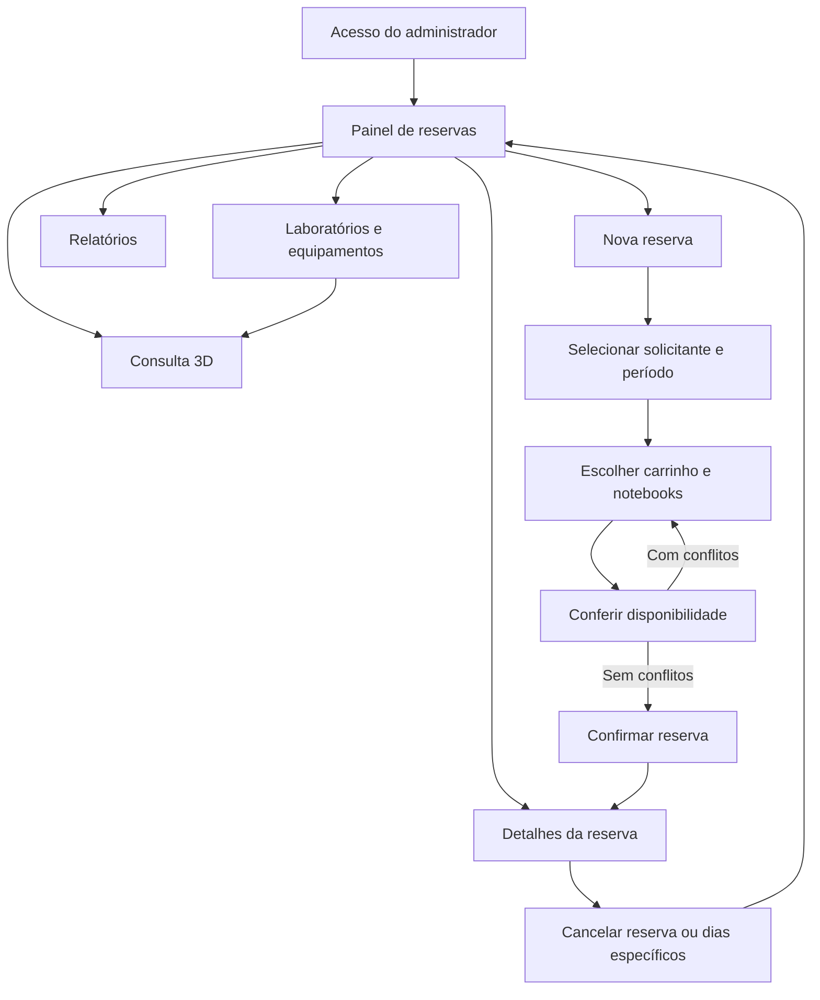

# Educart — Fluxos de tela (proposta inicial)

**Estado:** detalhamento de UX proposto a partir da especificação funcional; estrutura de navegação ainda sujeita a validação.
**Público da primeira versão:** administradores da equipe de TI.
**Fonte das regras:** [Especificação funcional](especificacao-funcional.md).

## Mapa de navegação proposto

## T01 — Acesso administrativo

**Objetivo:** identificar o usuário que executará registros e cancelamentos.

- Tela de entrada com identificação do administrador.
- Ao autenticar, acessar o painel de reservas.
- A reserva guarda o registrante automaticamente. Solicitante é informado separadamente.
- Método de autenticação e gestão de usuários ainda não definidos; **não desenhar credenciais fixas como decisão do projeto**.

## T02 — Painel de reservas

**Objetivo:** organizar a distribuição de equipamentos no dia a dia.

**Elementos propostos:** alternância semanal/mensal, navegação entre períodos, busca/filtros por solicitante, carrinho, turno e situação, lista/calendário de reservas, indicação de disponibilidade, ações Nova reserva, Detalhes, 3D e Exportar.

**Estados:**
- Sem reservas: mostrar informação de ausência e ação para cadastrar.
- Com reservas: cada item mostra data/turno, solicitante, carrinho, modalidade e ocupação.
- Reserva cancelada: manter no histórico sem ocupar disponibilidade.
- Falha de consulta: exibir erro e permitir tentar novamente.

**Ação principal:** escolher Nova reserva ou abrir uma existente.

## T03 — Nova reserva (formulário em etapas)

### Etapa 1 — Solicitante e utilização

- Selecionar/informar professor responsável.
- Escolher a modalidade de datas: **Intervalo contínuo** (campos data inicial e data final, permitindo semanas ou meses inteiros) ou **Dias específicos** (calendário de múltipla seleção, incluindo um único dia).
- Ao escolher um intervalo, incluir somente datas de **segunda a sexta-feira**, excluindo automaticamente sábados e domingos. Na seleção avulsa, desabilitar sábados e domingos com explicação acessível.
- Mostrar antes da confirmação as datas efetivas selecionadas, com contagem dos dias úteis selecionados e indicação de que fins de semana foram excluídos. Feriados e dias sem aula que ocorram de segunda a sexta-feira permanecem selecionáveis e contam normalmente na reserva; não há necessidade de cadastrar calendário escolar.
- Selecionar um ou vários turnos: matutino, vespertino, noturno.
- Prosseguir apenas com os campos obrigatórios preenchidos.

### Etapa 2 — Equipamentos e complementos

- Selecionar laboratório móvel pelo identificador e consultar sua capacidade.
- Escolher entre **Laboratório móvel completo** ou **Notebooks individuais**.
- Para notebooks individuais, informar quantidade e selecionar **os identificadores de cada notebook**; conferir coincidência entre quantidade e seleção.
- Exibir um checkbox **Precisa de mouse** (sim/não) e um campo de observações (opcional). A marcação apenas informa à equipe de TI que deve considerar o acessório ao preparar os equipamentos; não exige quantidade nem consulta estoque de mouses.
- Exibir quais notebooks estão livres e quais ocupados, considerando todas as datas e turnos selecionados.
- Não aceitar notebook pertencente a outro carrinho sem alteração explícita do carrinho escolhido.

### Etapa 3 — Validação e revisão

- Exibir resumo: solicitante, registrante, datas, turnos, carrinho, modalidade, identificadores e quantidade de notebooks, indicador de necessidade de mouse (sim/não) e observação. A necessidade de mouse não participa da validação de disponibilidade.
- Mostrar a lista de datas resultantes do intervalo ou da seleção avulsa para revisão antes de confirmar.
- Revalidar a disponibilidade **para cada combinação de data e turno**, mesmo quando for um mês inteiro.
- Se houver conflito, informar exatamente onde e quais notebooks estão indisponíveis, oferecendo voltar para trocar equipamento, reduzir a seleção ou trocar carrinho.
- Reserva completa com ocupação parcial naquele período não pode ser confirmada como completa; oferecer alternativa de reserva parcial.
- Só habilitar confirmação quando todo o conjunto estiver válido.

### Etapa 4 — Confirmação

- Salvar **uma reserva agrupada** com ocupações separadas por data e turno.
- Informar que a reserva foi registrada e abrir Detalhes.
- Atualizar painel, disponibilidade e 3D.
- Em falha de concorrência (outro administrador reservou antes), mostrar o novo conflito e evitar reserva duplicada.

## T04 — Detalhes da reserva

**Cabeçalho:** situação, professor solicitante, administrador registrante e carrinho.

**Conteúdo:** modalidade, notebooks por identificador, datas/turnos efetivos, mouse, observações e histórico dos períodos cancelados.

**Ações:** voltar ao painel, abrir carrinho no 3D, **Editar reserva** e cancelar a reserva inteira ou datas elegíveis. A edição permite alterar solicitante, notebooks/carrinho, datas e turnos, com nova validação de disponibilidade e histórico de alterações.

## T04-A — Editar reserva confirmada

1. No detalhe da reserva, o administrador seleciona **Editar reserva**.
2. O formulário é preenchido com o solicitante, carrinho, notebooks, datas, turnos, necessidade de mouse e observações atuais.
3. O administrador modifica os campos desejados e vê um resumo comparando **antes** e **depois**.
4. Ao continuar, o sistema verifica novamente a disponibilidade em todas as datas e turnos resultantes, considerando os bloqueios de outras reservas.
5. Havendo conflito, a tela indica exatamente equipamento, data e turno e oferece voltar para corrigir; **não altera nem libera a reserva anterior**.
6. Em confirmação bem-sucedida, salva a edição e as ocupações de forma indivisível, atualiza painel, consulta 3D e relatórios e registra data/hora, administrador e alterações no histórico.
7. Os detalhes da reserva permitem consultar o histórico de alterações sem apagar dados anteriores.

**Definido:** o botão **Editar reserva** permanece disponível aos administradores no próprio dia da utilização. O sistema registra quem editou, quando, e a comparação antes/depois, e revalida a disponibilidade para alterações de equipamentos ou turnos. **Cancelar a reserva inteira no próprio dia permanece bloqueado**; a edição não deve ser utilizada para simular esse cancelamento. O tratamento de alterações retroativas após a data da utilização ainda precisa ser definido.

## T05 — Cancelamento total ou parcial por data

1. Administrador abre Detalhes e seleciona Cancelar.
2. A tela apresenta todos os dias/turnos vinculados, destacando os períodos elegíveis.
3. Escolhe cancelar tudo que for permitido ou apenas datas específicas; confirma após visualizar o efeito.
4. Regra acordada: cancelamento normal permitido **até o dia anterior** à data de utilização. Tentativas no dia da reserva ou depois não são permitidas.
5. O sistema remove o comprometimento apenas dos períodos cancelados, preserva os demais, registra a alteração e atualiza disponibilidade, 3D e relatórios.
6. Exibe confirmação com os dias cancelados e preservados.

A confirmação de cancelamento não apaga o histórico.

## T06 — Consulta do laboratório móvel em 3D

- Filtros de carrinho, data e turno, e resumo dos notebooks reservados/disponíveis.
- Modelo genérico com carrinho e notebooks individualmente selecionáveis; permitir girar e aproximar.
- **Clique no notebook:** identificador, estado, professor solicitante se reservado, data, turno, mouse e observação.
- **Clique no carrinho:** identificador, capacidade, ocupação, reservas parciais/completas e disponibilidade.
- Legenda e tabela/lista textual equivalente: o acesso à informação não depende de 3D, clique preciso ou distinção somente por cor.
- Modelo sem dados ou falha de renderização não impedem registrar, consultar nem cancelar reservas.

## T07 — Relatórios e exportações

- Seleção de semana ou mês e navegação pelo período.
- Lista com solicitante, registrante, carrinho, notebooks, quantidade, datas, turnos, mouse, observações e situação.
- Resumo gerencial diferencia total de reservas agrupadas e ocupações por data/turno.
- Exportar PDF ou planilha respeitando os filtros ativos, incluindo registros cancelados com situação explícita.

## T08 — Cadastro e gestão de equipamentos

- Consultar carrinhos por identificador e sua capacidade informada.
- Acessar os notebooks cadastrados e identificadores associados a cada carrinho.
- Cadastrar/ajustar capacidade e notebooks é parte da administração do estoque.
- Oferecer opções **Informar códigos manualmente**, **Importar planilha** e **Gerar códigos automaticamente** para o cadastro de notebooks, inclusive em lote.
- Ao gerar códigos, o administrador informa a quantidade; a tela mostra os códigos propostos e permite editá-los antes de concluir.
- Na importação, permitir revisar e corrigir códigos antes de confirmar. Não exigir que os identificadores sejam números de patrimônio.
- Validar campos obrigatórios e códigos duplicados, mostrando erros no item correspondente, sem gravar registros inválidos.
- Mostrar quantidade de notebooks efetivamente cadastrados no carrinho após o registro.
- **Pendente de decisão:** como a interface deve lidar com diferença entre capacidade configurada e quantidade de notebooks individuais efetivamente cadastrados; não aplicar uma regra silenciosa.

## T09 — Pedidos de reserva pelos professores (futuro)

- Professor registra solicitação; pedido aparece como pendente para administradores.
- Administrador analisa datas, turnos e equipamentos e aprova ou rejeita.
- Aprovação precisa validar disponibilidade antes de produzir uma reserva efetiva.
- A tela e o comportamento de estoque de pedidos pendentes são assunto de fase posterior.

## Casos de navegação para teste

| Cenário | Resultado esperado |
|---|---|
| Carrinho com 20 notebooks; João reserva 1 para segunda/matutino | Os outros 19 continuam disponíveis naquele período; 3D identifica o notebook e João |
| Outro professor tenta o mesmo notebook segunda/matutino | Bloqueio por conflito e explicação |
| Outro professor escolhe outro notebook do mesmo carrinho segunda/matutino | Reserva parcial permitida se disponível |
| Professor escolhe o notebook de João segunda/vespertino | Permitido se não houver reserva nesse outro turno |
| Administrador tenta reservar o carrinho inteiro enquanto um notebook está ocupado no período | Impedir modalidade completa; indicar carrinho alternativo ou notebooks restantes |
| Reserva agrupada de segunda a quarta, manhã, com terça indisponível | Apontar terça/matutino e pedir correção antes de confirmar o conjunto |
| Professor solicita um laboratório por uma semana ou por um mês | Permitir intervalo de início e fim, considerar apenas segunda a sexta, exibir datas efetivas e verificar disponibilidade de cada data e turno |
| Intervalo inclui sábado e domingo | Excluir esses dias automaticamente sem ocupar notebooks; informar a exclusão na revisão |
| Administrador tenta escolher sábado ou domingo como data avulsa | Impedir a seleção e explicar que o Educart permite somente segunda a sexta-feira |
| Intervalo inclui feriado em dia útil | Manter o feriado nas datas efetivas; se a reserva for confirmada, o período ocupa os equipamentos normalmente |
| Administrador seleciona dia útil sem aula | Permitir a seleção, sem exigir cadastro de calendário escolar |
| Professor solicita somente segunda, quarta e sexta ou um único dia | Permitir seleção avulsa sem obrigar o preenchimento de datas intermediárias |
| Cancelamento elegível apenas da terça | Libera terça e mantém segunda/quarta, com histórico |
| Administrador altera professor solicitante em reserva confirmada | Mantém ocupação, atualiza o responsável e registra autor, data e mudança no histórico |
| Administrador troca notebook ou turno por outro livre | Revalida e atualiza os bloqueios e o 3D sem duplicidade |
| Administrador tenta trocar notebook por outro ocupado no mesmo turno | Impede salvar, mostra conflito e mantém a reserva anterior intacta |
| Administrador altera professor ou troca notebook no próprio dia da reserva | Permite a edição com revalidação de disponibilidade, atualiza dados e registra administrador, data/hora e antes/depois |
| Administrador tenta cancelar integralmente a reserva no próprio dia por meio da edição | Não permite contornar a restrição de cancelamento e mantém a reserva original |
| Cancelamento solicitado na própria data | Bloqueio conforme prazo acordado |
| Exportação semanal com reservas completas, parciais e canceladas | Dados e situações consistentes com o painel e com a ocupação |
| Cadastro em lote com geração de 10 códigos | A tela propõe 10 códigos distintos, permite editá-los e os valida antes de salvar |
| Importação de códigos próprios da equipe de TI por planilha | Os códigos são preservados, revisáveis e associados ao carrinho escolhido |
| Cadastro de identificadores repetidos | Registro inválido é impedido com indicação da duplicidade |
| Administrador marca **Precisa de mouse** | A necessidade aparece nos detalhes, no 3D e nos relatórios; a reserva não é bloqueada por estoque de mouses |

## Pontos para a próxima rodada de decisões

1. No cadastro dos carrinhos, a capacidade deve ser derivada dos notebooks cadastrados ou pode divergir temporariamente?
2. **Mouse (decidido):** somente marcação de necessidade sim/não, sem estoque ou quantidade por reserva.
3. **Decidido:** oferecer intervalo contínuo e dias avulsos, inclusive uma data única, **apenas de segunda a sexta-feira**; sábados e domingos são excluídos/indisponíveis. **Decidido:** feriados e demais dias sem aula de segunda a sexta-feira não recebem tratamento especial; podem ser reservados e permanecem bloqueando os equipamentos durante os turnos escolhidos.
4. **Decidido:** administradores podem editar reservas confirmadas inclusive no próprio dia da utilização, revalidando disponibilidade e registrando histórico. O cancelamento integral no próprio dia continua proibido. **Pendente:** tratamento de alterações retroativas após a data de uso.

Este documento **descreve os fluxos**, não indica que as telas já estejam implementadas.
