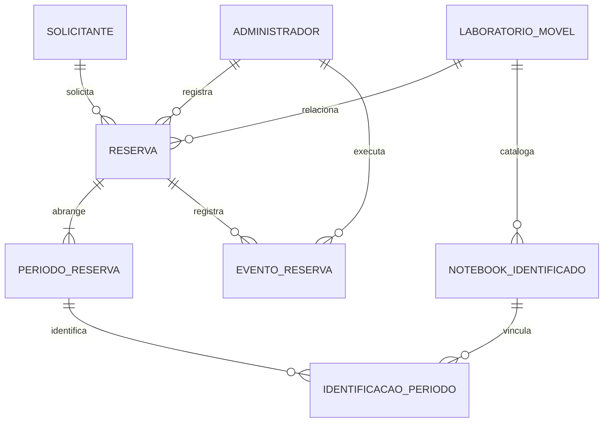

# Educart — Modelo conceitual de dados e regras de integridade

**Status:** proposta de modelagem atualizada conforme decisões confirmadas; não representa banco já implementado.
**Referências:** [Glossário](../GLOSSARY.md), [Especificação funcional](especificacao-funcional.md), [ADR 0001](adr/0001-notebooks-identificados-individualmente.md), [ADR 0002](adr/0002-disponibilidade-por-data-turno-e-equipamento.md), [ADR 0003](adr/0003-visualizacao-3d-como-projecao-das-reservas.md), [ADR 0004](adr/0004-capacidade-configurada-e-disponibilidade.md).

## 1. Princípio central

A **capacidade numérica configurada** no laboratório móvel é o estoque de notebooks disponível em cada data e turno, **independentemente de quantos notebooks têm códigos individuais cadastrados**. O saldo para uma data e turno é **capacidade configurada menos a soma de quantidades de reservas ativas naquele período**. Reservas completas ocupam toda a capacidade; reservas parciais ocupam a quantidade solicitada. O cadastro de códigos individuais serve para rastrear quais notebooks foram efetivamente destinados a cada professor, não para limitar o saldo.

Exemplo: carrinho de capacidade **30**, com apenas **28 identificadores conhecidos**, sem reservas: **30 disponíveis**. Se forem reservados 10 notebooks de manhã, restam **20 disponíveis de manhã**, independentemente dos cadastros individuais existentes. Outros turnos continuam com saldo 30, se não houver reservas neles.

Uma única reserva pode abranger várias datas e turnos; a utilização é controlada por período. O 3D e os relatórios consultam esse mesmo estado, sem manter estoque próprio.

## 2. Entidades propostas

| Entidade | Dados essenciais | Função |
|---|---|---|
| **Administrador** | id, nome, identidade de acesso a definir, ativo | Registra, edita, cancela, e é identificado no histórico |
| **Solicitante** | id, nome, ativo, outros dados a definir | Pessoa responsável pela utilização, distinta do registrante |
| **LaboratorioMovel** | id, codigo único, nome opcional, **capacidade_configurada (inteiro positivo)**, ativo | Carrinho cujo estoque reservável é definido pelo número informado |
| **NotebookIdentificado** | id, codigo único, laboratorio_movel_id, ativo | Catálogo opcional de códigos conhecidos; sua contagem **não limita a capacidade** |
| **Reserva** | id, solicitante_id, registrante_id, laboratorio_movel_id, modalidade (COMPLETA/PARCIAL), precisa_mouse, observacao, criado_em, atualizado_em, versao | Cabeçalho agrupado |
| **PeriodoReserva** | id, reserva_id, data_uso, turno, **quantidade_reservada**, cancelado_em opcional | Ocupação quantitativa concreta por carrinho, data e turno |
| **IdentificacaoPeriodo** | id, periodo_reserva_id, notebook_identificado_id (quando conhecido) | Identificadores associados aos notebooks separados para um período; complementa, mas não determina o saldo |
| **EventoReserva** | id, reserva_id, administrador_id, tipo_evento, ocorrido_em, antes, depois, detalhes opcionais | Auditoria de criação, edição e cancelamento |

`PeriodoReserva.quantidade_reservada` é o total efetivamente reservado, não necessariamente igual ao número de códigos em `IdentificacaoPeriodo`. Quando os códigos forem conhecidos, registrá-los e impedir atribuição simultânea do mesmo código físico em outra reserva.

**A definir no desenho da interface:** se os códigos ainda não cadastrados poderão ser informados no momento da reserva, na separação dos equipamentos ou em ambos. Isso **não altera** a capacidade e o saldo já aprovados. Nenhum identificador físico fictício deve ser inventado automaticamente para descrever equipamento real; os códigos gerados automaticamente são uma opção de cadastro administrativo, sujeita à validação.

## 3. Relacionamentos

## 4. Regras de integridade propostas

**I-01 — Capacidade como fonte de disponibilidade.** O campo `capacidade_configurada` é obrigatório e positivo; o sistema não infere capacidade a partir da contagem de códigos individuais. Para qualquer carrinho `C`, dia `D` e turno `T`: `saldo(C,D,T) = capacidade_configurada(C) - soma(quantidade_reservada ativa de C,D,T)`. O saldo nunca pode ser negativo.

**I-02 — Quantidade de cada período.** A quantidade reservada em cada `PeriodoReserva` é um inteiro positivo. Reservas completas ocupam exatamente `capacidade_configurada` em cada período, e só podem ser confirmadas quando não houver quantidade já reservada no período. Reservas parciais exigem saldo suficiente no conjunto de datas e turnos selecionados.

**I-03 — Identificadores opcionais para o cálculo.** Os códigos dos notebooks podem ser cadastrados manualmente, importados por planilha ou gerados e editados no cadastro administrativo. A quantidade de códigos previamente cadastrados não reduz a capacidade disponível. Quando códigos forem efetivamente informados numa reserva, devem corresponder ao carrinho, ser únicos e não estar vinculados simultaneamente a outra reserva ativa no mesmo período. A contagem de códigos associados a uma reserva não pode exceder sua quantidade reservada.

**I-04 — Dias e turnos.** Cada período corresponde a uma data (segunda a sexta-feira, inclusive feriados e dias sem aula) e um turno (MATUTINO, VESPERTINO ou NOTURNO). Não repetir `reserva_id + data_uso + turno`. Fins de semana não são reserváveis; intervalos os excluem automaticamente.

**I-05 — Concorrência e transações.** No momento de confirmar ou editar, o sistema precisa serializar ou bloquear a verificação de cada carrinho/data/turno de modo a impedir que dois administradores reservem, ao mesmo tempo, quantidades cujo total ultrapassaria a capacidade. Criar cabeçalho, períodos, identificações e auditoria em operação atômica; se qualquer período conflitar, manter o estado anterior integralmente. A implementação concreta pode usar travas transacionais/linhas de disponibilidade e constraints adequadas ao banco escolhido.

**I-06 — Reserva agrupada.** Um registro de `Reserva` pode conter muitos `PeriodoReserva`; ao selecionar intervalo ou datas avulsas, verificar todas as combinações data+turno antes de confirmar o conjunto. Não permitir confirmação parcial silenciosa.

**I-07 — Cancelamento por data e histórico.** O administrador pode cancelar reservas ou datas elegíveis somente até o dia anterior. O cancelamento de um período o exclui do somatório de quantidades ativas sem apagar o histórico. Outros períodos da mesma reserva permanecem ocupados.

**I-08 — Edição no próprio dia.** Administradores podem alterar solicitante, carrinho, quantidades e identificação de equipamentos, datas, turnos, mouse e observações no dia da utilização, com revalidação de saldo e códigos, atualização atômica e evento de auditoria com antes/depois. Edição não deve contornar a proibição de cancelamento integral no próprio dia; edições retroativas de períodos transcorridos ainda precisam ser detalhadas.

**I-09 — Autoria.** Solicitante é distinto de registrante; salvar administrador original e autoria de cada alteração/cancelamento. Não apagar eventos anteriores ao corrigir a reserva.

**I-10 — Mouse.** `precisa_mouse` é apenas booleano informativo e não possui estoque nem bloqueio de disponibilidade.

**I-11 — Relatórios e 3D.** Os relatórios distinguem uma reserva agrupada de cada período reservado e suas quantidades. O modelo 3D pode exibir **uma posição visual por unidade de capacidade**: a quantidade de posições ocupadas vem do total reservado no período; cada código individual só é exibido quando houver identificação conhecida, sem inventar códigos de patrimônio/da equipe de TI.

**I-12 — Alteração de capacidade.** Antes de reduzir `capacidade_configurada`, o sistema deve impedir que a nova capacidade seja inferior ao total reservado em qualquer período afetado. A política para reduções, manutenção e transferências de notebooks exige detalhamento adicional.

**I-13 — Auditoria temporal.** Datas são datas civis e turnos não equivalem a intervalos de hora. Registrar eventos com instantes inequívocos e usar fuso institucional coerente para verificar 'até o dia anterior'.

## 5. Exemplo de reserva e disponibilidade

Carrinho **C-01**, capacidade cadastrada **30**, com **28 códigos individuais** conhecidos.

- Antes das reservas, o painel apresenta **30 disponíveis** nos três turnos.
- João reserva **10 notebooks** segunda e terça, turno matutino: cria-se **1 Reserva** e **2 PeriodosReserva**, cada um com `quantidade_reservada = 10`.
- O saldo no carrinho fica **20 disponíveis na segunda/matutino** e **20 na terça/matutino**.
- Maria pode reservar até **20 notebooks** nesse mesmo carrinho/turno, desde que os códigos individuais informados não conflitem.
- A reserva completa desse carrinho nesses dois períodos é bloqueada enquanto houver os 10 reservados.
- Cancelar o período de terça (se dentro do prazo) devolve o saldo de terça para **30**, mantendo segunda com saldo **20**.
- O 3D mostra **30 posições**, dez reservadas no período de João e vinte disponíveis, exibindo códigos conhecidos sem criar identificadores fictícios.

## 6. Evolução futura

Um pedido feito pelo professor poderá existir como entidade **SolicitacaoReserva** com estado pendente, revisão pelo administrador e conversão em `Reserva` após nova verificação de saldo. Ainda não está decidido se um pedido pendente bloqueia quantidade temporariamente.

## 7. Questões ainda em aberto

1. **Identificação operacional:** como o administrador atribui códigos que ainda não constam no cadastro aos notebooks reservados, sem exigir cadastramento antecipado da capacidade inteira.
2. **Redução da capacidade/manutenção:** política para notebooks ausentes ou indisponíveis e alteração do total configurado.
3. **Alterações retroativas:** regras para edição de períodos cuja data já passou.
4. **Autenticação e papéis:** detalhes de cadastro dos administradores e solicitantes.
5. **Stack técnica:** banco, ORM e mecanismos concretos de concorrência, ainda não escolhidos.

**Status:** documentação conceitual atualizada; nenhuma migração, tabela física ou aplicação foi criada por este documento.
