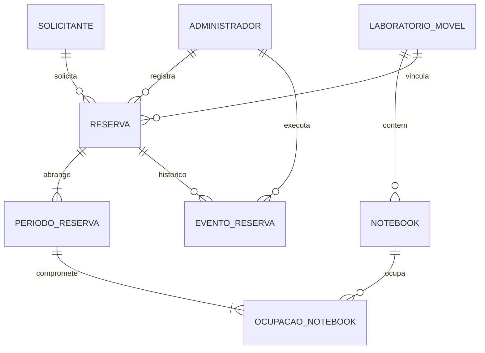

# Educart — Modelo conceitual de dados e regras de integridade

**Status:** proposta de modelagem para revisão; não representa tabelas já implementadas.
**Referências:** [Glossário](../GLOSSARY.md), [Especificação funcional](especificacao-funcional.md), [ADR 0001](adr/0001-notebooks-identificados-individualmente.md), [ADR 0002](adr/0002-disponibilidade-por-data-turno-e-equipamento.md), [ADR 0003](adr/0003-visualizacao-3d-como-projecao-das-reservas.md).
**Escopo:** primeira versão administrativa, com extensão planejada para solicitações feitas por professores.

## 1. Princípio central

Uma **Reserva** é a solicitação confirmada de um conjunto de notebooks de um carrinho em um ou vários dias e turnos. Uma reserva agrupada pode ser criada uma única vez, mas o bloqueio físico de cada notebook ocorre na granularidade **notebook + data + turno**. Uma reserva completa seleciona todos os notebooks do carrinho no período; uma parcial, apenas os notebooks identificados. O campo `precisa_mouse` é uma sinalização, não estoque.

A interface 3D, os relatórios e os calendários devem consultar os mesmos dados operacionais, sem manter cópias independentes do estado da disponibilidade.

## 2. Entidades propostas

| Entidade | Dados essenciais | Relação / função |
|---|---|---|
| **Administrador** | id, identidade de autenticação (a definir), nome, ativo | Registra, edita e cancela reservas; ações identificáveis no histórico |
| **Solicitante** | id, nome, ativo; demais dados a definir | Pessoa em nome de quem o equipamento é reservado; não precisa de conta na versão inicial |
| **LaboratorioMovel** | id, codigo único, nome opcional, capacidade_informada, ativo | Identifica o carrinho; capacidade configurável |
| **Notebook** | id, codigo único, laboratorio_movel_id, ativo | Notebook identificado individualmente e associado a um carrinho |
| **Reserva** | id, solicitante_id, registrante_id, laboratorio_movel_id, modalidade (COMPLETA/PARCIAL), precisa_mouse, observacao, criado_em, atualizado_em, versao | Cabeçalho de uma reserva agrupada, com responsável e registrante diferentes |
| **PeriodoReserva** | id, reserva_id, data_uso, turno (MATUTINO/VESPERTINO/NOTURNO), cancelado_em opcional | Um dia e turno selecionado dentro de uma reserva. Permite cancelar uma data sem apagar as demais |
| **OcupacaoNotebook** | id, periodo_reserva_id, notebook_id, cancelado_em opcional | Associação concreta entre notebook e período; é a fonte para calcular disponibilidade |
| **EventoReserva** | id, reserva_id, administrador_id, tipo_evento, ocorrido_em, antes, depois, detalhes opcionais | Registro auditável de inclusão, alteração e cancelamento, preservando versões anteriores |

O campo `capacidade_informada` é separado do **total de notebooks cadastrados** (obtido por contagem). A regra para divergências **não está aprovada**; não usar a capacidade informada como permissão para reservar notebooks que não existem no cadastro. A política de desativação e de transferência de notebooks com histórico também será detalhada.

## 3. Diagrama de relacionamentos

Os relacionamentos indicam o fluxo lógico. Uma reserva confirmada exige ao menos um período e uma ocupação em cada período; registros cancelados são mantidos no histórico. O armazenamento técnico (SQL, ORM, nomes finais das colunas) será escolhido posteriormente.

## 4. Regras de integridade indispensáveis

**I-01 — Códigos únicos e válidos.** `LaboratorioMovel.codigo` e `Notebook.codigo` são obrigatórios e únicos nos respectivos conjuntos. Entrada manual, importação e geração automática passam pela mesma validação. A normalização de maiúsculas/espaços deve ser consistente para impedir duplicidade disfarçada.

**I-02 — Associação correta.** Cada notebook pertence a um carrinho. Todas as ocupações de uma reserva devem referenciar notebooks pertencentes ao carrinho informado naquela reserva. Não permitir transferência de notebook que produza inconsistência com reservas existentes; política de transferências a definir.

**I-03 — Dias e turnos válidos.** `PeriodoReserva.data_uso` aceita somente segunda a sexta-feira; feriados e dias sem aula em dias úteis continuam válidos. O turno é um dos três valores definidos. Não repetir a mesma combinação `reserva_id + data_uso + turno`.

**I-04 — Exclusividade de ocupação ativa.** Em qualquer instante, só pode haver **uma ocupação ativa** para cada `notebook_id + data_uso + turno`, inclusive entre reservas de administradores distintos. Essa regra precisa existir na camada transacional/persistência, não só na interface. Como `data_uso` e `turno` estão em `PeriodoReserva`, uma implementação relacional pode materializar esses campos na ocupação com validação transacional e restrição única sobre as ocupações ativas, ou adotar estrutura equivalente que garanta a exclusividade.

**I-05 — Confirmação atômica.** Ao confirmar reserva para vários dias, criar cabeçalho, períodos e ocupações como uma única operação atômica. Se uma combinação conflitar ou falhar, não confirmar parte do conjunto. Revalidar no momento do salvamento e proteger concorrência.

**I-06 — Modalidade completa/parcial.** Reserva completa inclui **todos** os notebooks efetivamente cadastrados e elegíveis do carrinho, sem conflito, em todos os períodos. Reserva parcial inclui exatamente os identificadores selecionados; a quantidade exibida deriva dessa seleção, sem contador paralelo inconsistente. Se a capacidade informada divergir dos cadastrados, alertar e aplicar política ainda a decidir; não inventar equipamentos.

**I-07 — Cancelamento com histórico.** Cancelamento normal por administrador é permitido somente até o dia anterior à utilização. Ao cancelar uma data de reserva agrupada, desativar as ocupações e períodos daquela data, preservando as outras datas e o evento de auditoria. Nunca excluir fisicamente o registro para 'liberar' o notebook.

**I-08 — Edição auditável, inclusive no mesmo dia.** Alterações de solicitante, carrinho, notebooks, datas, turnos, mouse ou observações podem ser feitas pelo administrador no próprio dia da utilização. Validar as novas ocupações excluindo os registros **da própria reserva** da checagem de conflito, mas não as outras reservas. Substituir ocupações e gravar o evento antes/depois na **mesma transação**. Rejeitar edição conflitante sem tocar no estado anterior. Não usar edição para cancelar integralmente uma reserva no próprio dia, em desrespeito à regra de cancelamento.

**I-09 — Registro de autoria.** O administrador registrante não é necessariamente o solicitante. A autoria de cada edição/cancelamento, data/hora e diferenças de valores deve permanecer consultável mesmo após mudanças posteriores.

**I-10 — Mouse.** `precisa_mouse` é booleano por reserva, aparece nos detalhes, 3D e relatórios e nunca bloqueia disponibilidade. Não criar entidade de estoque de mouse nesta versão.

**I-11 — Estatísticas corretas.** Relatórios precisam distinguir **número de reservas** (cabeçalhos) de **ocupações por notebook/data/turno**. Cancelamentos não contam como ocupações ativas; o histórico permanece acessível.

**I-12 — Datas e horários de auditoria.** Datas da reserva são datas civis sem horário; turnos são categorias. Registrar eventos com instante e fuso inequívocos. O fuso institucional utilizado para limites 'dia anterior' precisa ser definido na configuração técnica para evitar erros em viradas de dia.

## 5. Exemplo de funcionamento

Carrinho `C-01` com três notebooks cadastrados `NT-01`, `NT-02`, `NT-03` (capacidade apenas ilustrativa). João reserva `NT-01` na segunda e terça, turno matutino.

- Surge **1 Reserva**, **2 PeriodosReserva** e **2 OcupacoesNotebook**.
- Maria pode reservar `NT-02` e `NT-03` nesses períodos, mas não `NT-01` no mesmo dia e turno.
- João pode reservar `NT-01` na segunda/vespertino, se livre.
- Cancelar apenas terça libera `NT-01` na terça/matutino, sem liberar segunda; o evento fica auditado.
- No 3D, selecionar terça/matutino mostra apenas as ocupações ainda ativas da data/turno.
- Um relatório de reservas pode contar João uma vez; um relatório de utilizações conta dois períodos originalmente programados e distingue o período cancelado.

## 6. Caminho previsto para solicitações futuras

Quando professores puderem iniciar pedidos, considerar uma entidade **SolicitacaoReserva** vinculada ao solicitante, à proposta de períodos/equipamentos e à decisão do administrador. Uma solicitação pendente **não deve ser tratada automaticamente como reserva confirmada**. A política de retenção/bloqueio temporário de estoque para pedidos pendentes ainda depende de decisão. A criação da reserva após aprovação reutilizará as mesmas validações de integridade.

## 7. Decisões que ainda precisam ser fechadas

1. **Capacidade do carrinho:** como reconciliar capacidade informada versus notebooks efetivamente cadastrados e elegíveis, inclusive quando um notebook for retirado para manutenção.
2. **Alterações retroativas:** permitir ou impedir edições de períodos que já passaram; edições no próprio dia já estão aprovadas.
3. **Manutenção e baixa:** o que fazer quando um notebook fica indisponível ou muda de carrinho com reservas futuras.
4. **Identificação de solicitantes e administradores:** detalhes do cadastro, autenticação e permissões.
5. **Tecnologia de persistência:** banco, ORM e mecanismo exato para a restrição de concorrência; este documento não escolhe a stack.

**Próxima recomendação:** decidir a política de capacidade e indisponibilidade física antes de elaborar migrações SQL e API, porque esses detalhes determinam quais notebooks podem ser reservados.
