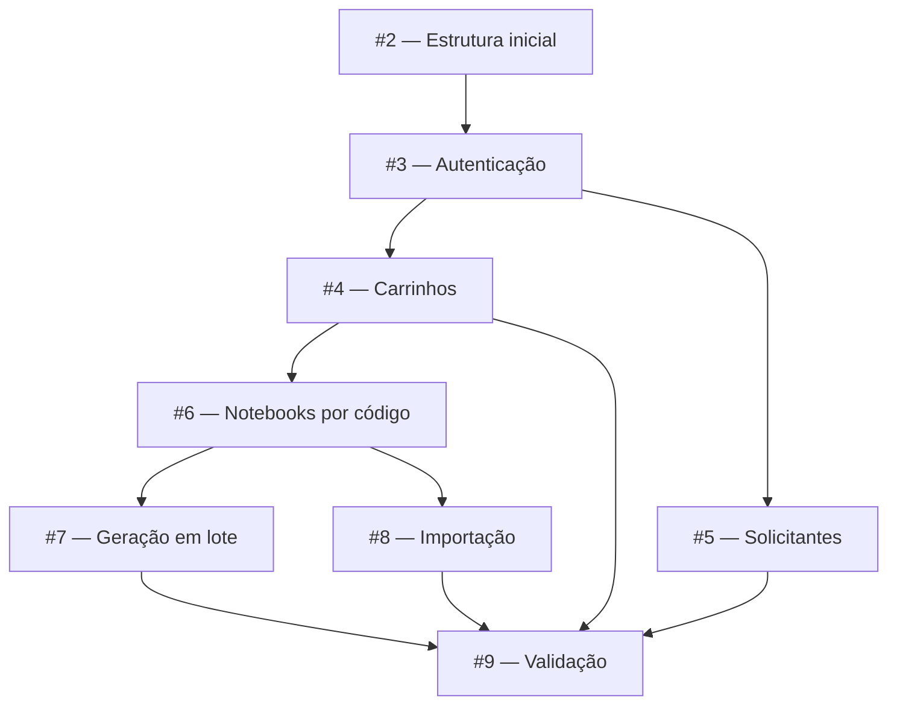

# Educart — Fase 1: tarefas para implementação

**Estado:** plano publicado, **sem implementação iniciada**. O desenvolvimento depende de autorização explícita.
**Fonte:** [Issue de especificação #1](https://github.com/dev-oestagiario/Educart/issues/1) e [especificação detalhada](spec-fase-1.md).
**Método:** `to-spec` para especificar, `to-tickets` para criar fatias verificáveis com relações de bloqueio.

| Ordem | Ticket | O que entrega | Bloqueado por |
|---|---|---|---|
| 1 | [#2 — Estrutura inicial e painel](https://github.com/dev-oestagiario/Educart/issues/2) | Aplicação navegável, layout administrativo e base de testes | Nenhum |
| 2 | [#3 — Autenticação de administradores](https://github.com/dev-oestagiario/Educart/issues/3) | Login/logout com Supabase Auth, acesso protegido e RLS | #2 |
| 3 | [#4 — Cadastro de carrinhos](https://github.com/dev-oestagiario/Educart/issues/4) | Criar/consultar/editar carrinhos com capacidade configurada | #3 |
| 4 | [#5 — Cadastro de solicitantes](https://github.com/dev-oestagiario/Educart/issues/5) | Gerenciar professores/solicitantes separados das contas de TI | #3 |
| 5 | [#6 — Notebooks por código](https://github.com/dev-oestagiario/Educart/issues/6) | Cadastrar e consultar notebooks identificados sem reduzir a capacidade | #4 |
| 6 | [#7 — Geração em lote](https://github.com/dev-oestagiario/Educart/issues/7) | Gerar vários códigos com revisão e edição antes de salvar | #6 |
| 7 | [#8 — Importação de planilha](https://github.com/dev-oestagiario/Educart/issues/8) | Importar códigos com prévia, validação e correção | #6 |
| 8 | [#9 — Validação integrada](https://github.com/dev-oestagiario/Educart/issues/9) | Validar fluxo completo com testes e revisão de segurança | #2–#8 |

## Grafo de dependências

O ticket #9 também depende do encerramento de #2 e #3, conforme sua issue. A geração em lote e a importação podem ser executadas em paralelo após #6.

## Critérios da fase

- Administradores autorizados conseguem entrar e realizar cadastros; pessoas não autorizadas não conseguem acessar dados nem pela API.
- Carrinho com capacidade configurada para 30 continua com capacidade 30 mesmo que haja somente 28 códigos individuais cadastrados.
- Códigos repetidos ou inválidos são rejeitados. Alterações atualizam consultas na interface.
- UI responsiva e acessível, com testes de componentes, integração de permissões e jornada E2E.
- Não estão incluídos reservas, cancelamentos, relatórios e 3D nesta primeira fase, conforme [planejamento geral](stack-mvp.md).

## Antes de programar

- Revisar se a divisão e as dependências fazem sentido.
- Confirmar o projeto Supabase e o método de provisionamento dos dois administradores.
- Definir formato de planilha de importação.
- Confirmar, se necessário, se “Stage” se refere a Zustand.
- Obter autorização explícita para iniciar a implementação.

**Nenhum arquivo de código, dependência ou migração do Supabase foi criado por este planejamento.**
